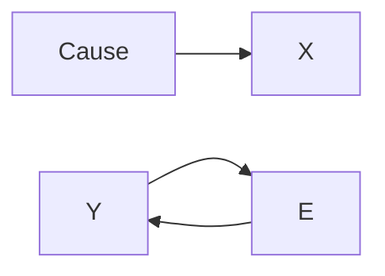

# ArchiScript

A Lean calculus for making architectural assumptions and member consequences
explicit before implementation.

ArchiScript makes architectural ignorance visible as an unmet semantic or proof
obligation. An omitted outcome should not disappear behind a convenient carrier,
a hidden member branch, an invented waiting loop or an unexplained tensor join.

**Global Cone/Expression coverage: NOT AUTOMATICALLY VERIFIED.** Certificates
cover the declared semantic objects and derived contexts described below.
The checker does not establish that the union of declared Cones covers every
finite typed Expression generated by the primitive inventory. Per-Cone proofs
and local `effectCoverage` do not establish that global property. Real-world
inventory completeness remains an author assumption.

### Manual inventory audit

**Global Cone/Expression coverage: NOT AUTOMATICALLY VERIFIED.** Disconnected
declared nodes, rootless strongly connected components (SCCs), and unaccounted-for
subgraphs are not automatically excluded. `CertifiedDeclaredArchitecture` proves
its scoped fields, not that every declared node or Operation has a grounded Cone.



[UngroundedCycle.lean](ArchiScriptTests/UngroundedCycle.lean) accepts a restricted
certificate for this inventory although Y and E have no canonical Cause-rooted
producer. Its typed cyclic boundary does not prove grounding.
[SourceCoverage.sourceOnly](ArchiScriptTests/SourceCoverage.lean) likewise retains
unattached Y/E nodes in an accepted unobservable model.

Without dependencies or context predicates connecting it to a rooted route, the
isolated component supplies no producer and does not change that route's reachable
tuples. It can still create false confidence in inventory coverage. Conversely,
an unrelated component owned by an observable Cone can obstruct
`BoundariesComplete`: every owned node needs a path to an Effect boundary when
`NoObservableEffect` is unavailable. Marking a cyclic boundary may satisfy the
path condition without proving a rooted producer.

Before claiming architecture-wide completeness, the architecture/diagram author
must inspect the entire declared Cause, Node/VDP and Generator/Operation inventory,
including unused declarations and rootless cycles. Remove accidental leftovers,
document intentional unreachable components and exclusions, or repair omitted
Causes/dependencies and rerun local proofs. Record this as an author judgment,
not a Lean guarantee. Adding a connection requires fresh supplier and contextual
P/E checks. A reachable X with unsourced Y at a declared join remains a present
certification failure, not this deferred audit. The [0.8.0 plan](plans/0.8.0.md)
separates inventory-wide diagnostics from all-generated-Expression coverage.

## Semantic foundation

Declare a complete meaningful carrier, including failed, invalid and absent
cases. Declare named semantic Subdomains and their ancestry. Prove every declared
split. Select a finite nonempty family of those regions as the VDP's members.

### A priori possibility space

Before validating downstream consequences, the architect states the meaningful
boundary carrier, outcome-relevant predicates, external Causes, primitive
Operations, context/availability assumptions and independent admissibility
contracts. The model accounts for the possible cases and their conditions in
advance. A running implementation can discover which case holds later.

This is knowledge of **possible behavior**, not foreknowledge of one execution.
Possible PRNG or CSPRNG outputs can be modeled without predicting a sample or
specifying a distribution; a VDP carries no probability weights. Lean proves
facts about the declared interpretation, not that it captures the real world.

One Cause denotes one concrete external event and has one whole initial VDP:
`ArchitectureSignature.start c` selects its node, and `object (start c)` its VDP.
Several downstream Operations can express non-exclusive possible structural
consequences of that same source occurrence. They add neither initial VDPs nor
external invocations, and imply no parallel runtime execution.

Information need not all reside in a Cone's first VDP. Explicit external Causes,
sourced factors, provenance and justified context can contribute it through
declared dependencies and joins. A new distinction needs an explained semantic
source before the affected Operation's member mapping is asserted.

| Concept | Enforced meaning |
| --- | --- |
| `Domain α` | Predicate; intermediate emptiness is permitted |
| `Subdomain α` | Explicit base, definition evidence, containment and inhabitant |
| `SemanticSplit parent` | Finite nonempty children covering the parent, internally disjoint |
| `VDP` / `Partition` | Declared Subdomain members with full carrier coverage and disjointness |
| `Operation X Y` | Possibly partial, non-surjective member map between whole verified VDPs |
| `Expression G X Y` | Finite linear chain of registered Operations between nominal objects |
| `Presentation` | Nonlinear algebraic presentation syntax, separate from linear routes |
| Cause / Cone | One originating Cause, explicit root instance and all supported consequences |
| Contextual Effect | Terminal boundary image or full Cone-effect tuple relation |

Different decomposition trees may share a root and overlap across trees. Flat
member selections and coarsenings remain valid. Every **named** Subdomain is
nonempty; an empty string, array or absence value is not the empty set.
`Partition.classify` is a derived classical lookup, never a construction field.
Carriers may be infinite while member families remain finite.

The [project-reference example](ArchiScriptExamples/ProjectReference.lean)
uses verified deductive splits for all eight URI success/failure leaves. Its
symbolic URI/filesystem interpretation is explicit; it is not a parser or a
proof that real filesystem observations are truthful. A counterexample rejects
promoting only the successful leaves into the full URI boundary.

### Click, wait and timeout

For one external lobby-entry click, choose a declared **scenario** carrier with
an arbitrary natural-number waiting budget `b` and `readyAfter : Option Nat`.
`some d` means readiness after `d` abstract ticks; `none` means no readiness in
that scenario. The example adopts success at the deadline and a short-wait
threshold of two ticks.

| Initial semantic member | Predicate over the scenario | Witness `(b, readyAfter)` | `decide` result |
| --- | --- | --- | --- |
| `ShortWait` | Readiness at `d ≤ 2` and `d ≤ b` | `(5, some 1)` | `Success` |
| `LongWait` | Readiness at `2 < d ≤ b` | `(5, some 4)` | `Success` |
| `Timeout` | No readiness, or readiness at `b < d` | `(5, none)`; also `(5, some 6)` | `Timeout` |

[PossibilitySpace.lean](ArchiScriptExamples/PossibilitySpace.lean) proves these
regions nonempty, exhaustive and disjoint over the entire infinite carrier and
defines `decide : Operation click result`. Zero budgets, immediate readiness,
deadline equality and arbitrarily late readiness remain present. It proves the
partition/map layer, not a complete Cause/Cone certificate.

This carrier is a declared mathematical boundary, **not raw-input validation**.
Its interpretation assumes readiness is meaningfully summarized by a delay;
cancellation, malformed requests or other relevant conditions need explicit
semantics if the real boundary includes them. The program need not read or
predict a future delay at click time. The model states possible scenarios; it
proves no eventual readiness, timeout delivery, timing bound or implementation
waiting strategy.

A literal singleton `Click` cannot be split into three inhabited disjoint
regions merely by naming them after outcomes. For a lobby requiring N people,
state the relevant environmental distinctions or explicitly sourced dependency.
Do not invent N parameterized Causes or a polling self-loop merely to depict
waiting. A genuine declared architectural cycle remains legal.

### An unexplained branch is a modeling failure

One coarse input member `Waiting` cannot map to both unequal members `Success`
and `Timeout` through **one and the same Operation**. Its
`Operation.run : X.MemberIndex → Option Y.MemberIndex` is a partial function;
`Operation.single_output` proves that two defined outputs at one input are equal.
[HiddenWaitingBranch.lean](Test/Negative/HiddenWaitingBranch.lean) deliberately
fails when authoring the second conflicting branch.

Refine an appropriately broad carrier, add an explicitly sourced factor, or
justify the context-specific semantics before declaring that map. Making the
proof pass by discarding a possible case hides the architectural problem.
Separate outgoing Operations `f : X → Y` and `g : X → Z` are valid fan-out.
`none` is mathematical undefinedness, not an undocumented alternate output or a
claim that a runtime Operation did not execute.

## Operations, tensor and provenance

`g.comp f` composes defined member mappings. `none` denotes mathematical
undefinedness, without a runtime execution claim. Several outgoing Operations
are non-exclusive possible structural routes, with no scheduler or liveness rule.

Tensor preserves the full Cartesian carrier and member product, including self
tensor. Coproduct preserves tagged alternatives. Common-source fan-out creates
no implicit diagonal Operation. At an actual tensor use, the relevant questions are

\[
\begin{aligned}
\text{(P)}\quad &\forall i,\quad \pi_i(\operatorname{Adm}_t)=I_i,\\
\text{(E)}\quad &\operatorname{Reach}_t=\operatorname{Adm}_t.
\end{aligned}
\]

### Level A: correctness of the stated local contract

For `t : X₁ ⊗ ... ⊗ Xₙ`, identify every actual producer occurrence and its
provenance. Derive each incoming image `Iᵢ` independently from that supplier's
semantics, before restricting the join. `Adm_t` is an independently authored
predicate on **full tuples**. `Reach_t` is the reference relation from the actual
provenance, boundary/world and context assumptions.

**P is necessary coverage, not sufficient joint behavior.** Every actual incoming
member needs at least one admissible full partner tuple, and the contract must
not invent unsupplied coordinates. **E compares the complete relation in both
directions.** Every reachable tuple must be approved and every approved tuple
must be reachable. Neither projections, pairwise checks nor selected examples
establish E.

Together P and E are the exact adequacy criteria for a local formal contract
defined by these obligations, with the API's additional inhabited/unreachable
status requirements. This is a conditional mathematical result for that stated
contract, not a theorem that every architectural design is correct. Declare
`Adm` independently; setting `Adm := Reach` or assuming equality through an
unchecked axiom supplies no independent contract. Proof audits and named
assumptions remain part of the evidence.

Neither an Operation nor a supplier must reach every member of its target VDP.
`Adm` and `Reach` may be proper subsets of the unchanged full product.

### Correlation, partners and complete tuples

Let `f,g : X → Bool` both preserve the input Boolean from **one shared Cause
occurrence**. The supplier paths remain distinct. A declared downstream
`j : Bool ⊗ Bool → R` explicitly consumes both:

| Pair in the full mathematical tensor | Common-source `Reach` | Independent diagonal `Adm` |
| --- | --- | --- |
| `(false, false)` | Reachable | Admissible |
| `(false, true)` | Unreachable | Excluded |
| `(true, false)` | Unreachable | Excluded |
| `(true, true)` | Reachable | Admissible |

[CorrelatedJoin.lean](ArchiScriptExamples/CorrelatedJoin.lean) proves the exact
input relation and its projections. Declaring all four pairs admissible would
fail E unless independent semantics actually supplied the off-diagonal pairs.
Fan-out and equal VDP names create no join: the consuming generator and both
supplier histories must exist. The terminal Cone-effect tensor is an analytical
product; it adds no architectural join Operation.

If an incoming factor can produce `a` but no full admissible tuple contains `a`
at its position, P fails: `a ∈ Iᵢ` but `a ∉ πᵢ(Adm)`. A contract tuple using an
unsupplied member fails the reverse inclusion. A constant producer may reach
only `true` in a Boolean VDP; unreachable `false` needs no partner. If a required
factor has no supplier while another has an inhabited incoming image, losing
the complete input term does not discharge these obligations: no full tuple
can cover that supplied member. Such a use must surface as missing/unverified,
not disappear from certification.

Three Boolean factors show why P alone cannot suffice. Suppose `Reach` contains
all eight triples, while independently declared `Adm(a,b,c)` means
`c = xor a b`:

| Relation check | Result |
| --- | --- |
| Each coordinate projection | Both relations contain `false` and `true`; P passes |
| Every pair extends to a full tuple | Both relations have all four pairs at every pair of positions |
| Full tuples | `Adm` has four triples; `Reach` has eight; E fails |
| Concrete counterexample | `(false, false, true)` is reachable but prohibited |

[TensorVerification.lean](ArchiScriptTests/TensorVerification.lean) proves
`pairwise_is_insufficient` and records the four excluded triples, an orphaned
incoming member, and the legitimate strict image of a constant supplier.
[ContractCoverage.lean](ArchiScriptTests/ContractCoverage.lean) applies these
failures to typed generator inputs with actual producers: an orphan, an invented
coordinate, and a three-factor relation whose projections pass while E fails.
Projection coverage exposes missing partners early; passing it never licenses
skipping the full n-ary relation.

`ArchitectureSignature` closes the declared primitive, Cause, node, domain and
split inventories. `Inputs` records actual generator suppliers. Finite provenance
`Term`s retain root instances and producer histories; they are not single linear
Expressions. Equal VDP denotations do not merge nominal nodes or factor positions.
`isInputContext` derives local contexts from their real originating roots.
`Term.RootCoherent` requires every Cause occurrence, including a nested external
supplier, to use that Cause's designated origin. Distinct producer paths from
that origin remain distinct and can be joined.

Every declared generator must also satisfy `InputSources`, before a complete
input term is available. It requires coherent suppliers at every factor or proof
that all independently incoming factor images are empty. One supplied X and a
missing Y cannot bypass a declared `X ⊗ Y → E` check.
`CertifiedDeclaredArchitecture.input_partner` proves that every independently
incoming member has a full admissible, reachable partner tuple. Choosing one
grounding witness does not restrict the universal checks on other input contexts.

Two distinct external Causes may have equal initial VDPs while remaining
provenance-distinct. An explicit cross-Cone join is legitimate;
[CrossCone.lean](ArchiScriptExamples/CrossCone.lean) supplies one local and one
external factor with declared boundary and availability semantics. By contrast,
combining two invocations of the **same** Cause at different simulated times is
outside the current single-event Cone API. That would require a separate future
external multiple-event simulation/composition extension. Neither valid fan-out
nor legitimate cross-Cone joins should be removed to hide this distinction.

The reference relation includes every finite derivation from the inventory,
including recursive cross-Cone dependencies. Availability is an explicit
semantic assumption. No default physical persistence, consumption, synchronization
or resource-effect semantics is introduced.

## Cycles and proof-backed checking

A cycle needs a real typed entry and observation boundary. `Term.CycleBoundary`
records a nontrivial return with one entry hole and explicit auxiliary suppliers.
Repeated traversals of that return contribute to the selected boundary image;
they do not add a factor per iteration. Distinct producer entries remain distinct,
including when they enter the very same marked node.

Reachable sets may stabilize while the Operation continues alternating.
[The swap example](ArchiScriptExamples/CyclicCone.lean) proves both facts and
connects its boundary image to a finite exact analysis through `ExactAbstraction`.
A finite VDP alphabet does not imply finitely many occurrence histories.
The provenance proof cache requires every Cause's designated origin and a seeded,
closed, realized finite normalized-history basis (`effectCoverage`).
It need not enumerate every value of the root-instance type; unsupported
additional invocations cannot enter accepted derivations.
The optional `derive_provenance` helper caches candidate data; it does not supply
this proof or infer closure from a fuel limit.
`FiniteAnalysis.certify` checks closure of the entire analyzed state before
returning an `Exact` result; an unchanged terminal projection is insufficient.

`CertifiedDeclaredArchitecture` requires a nonempty Cause inventory, source
accounting for every generator, proofs for all derived local input contexts,
and an explicit `ConeStatus` for every Cause. An observable Cone needs a real
Effect coordinate, a reachable full tuple, P/E proofs and complete terminal
boundaries. An unobservable Cone needs `NoObservableEffect`: every Effect
coordinate's incoming image and its admissibility relation are empty. This
admits an intentionally source-only event without inventing an observation;
it cannot hide missing input suppliers. The tensor unit never counts as an
observable Effect. [SourceCoverage.lean](ArchiScriptTests/SourceCoverage.lean),
[Unobservable.lean](ArchiScriptTests/Unobservable.lean) and
[UngroundedCycle.lean](ArchiScriptTests/UngroundedCycle.lean) check these cases.

Certificates establish necessary obligations of the declared model. They do not
establish missing real-world requirements, production-code conformance, fairness,
termination, races or physical concurrency.

### Level B: correctness of the real-world design

Even a fully proved model of its declared scope is necessary evidence, not
sufficient proof that the proposed architecture is complete, appropriate,
implementable, secure, performant or faithful to production. An author can omit
an external Cause, choose the wrong carrier or predicates, or approve the wrong
`Adm`. Lean checks implications within the supplied interpretation; external
validity needs architectural scrutiny and separately modeled evidence.

Report two verdicts: which mathematical obligations were proved for the declared
scope, and which external assumptions or design risks need human review.
**Global Cone/Expression coverage: NOT AUTOMATICALLY VERIFIED.** Local/per-Cone
success does not establish the deferred universal generated-path guarantee.

## Algebra

The calculus provides partial-map identity/associativity, symmetric monoidal
coherence/naturality, coproduct universal properties, canonical tensor/coproduct
distributivity, semantic VDP isomorphisms, refinement/coarsening and conditional
consumer factorization. Isomorphisms preserve the primary semantic predicates.

`Presentation.Rewrite` checks Operation equality; `Presentation.Transport` checks
an explicit isomorphism square. These are local algebraic facts, not Cone-effect
equivalence. Composition never deletes intermediate nominal objects; a view
hiding them is an architecture projection. Selected `Presentation.Family` values
are useful views, not completeness certificates.

## Build and trust boundary

Lean/Lake are pinned to **4.34.0**. Runtime examples need Node; repository tooling
uses Python through `uv`. Optional review PDFs use Tectonic.

```bash
uv run --no-project python scripts/verify-lean.py
uv run --no-project python -m unittest discover -s scripts -p 'test_*.py'
node --test examples/payment-webhook.test.mjs
```

The first command cleans and builds with warnings as errors, checks the public-library
skill smoke, audits compiled transitive axioms, runs intended-diagnostic negative
fixtures and invokes kernel replay with explicit module names. Reports are in
`.lake/reports/verification.json` and `.lake/reports/axioms.json`. Verification
rejects changing sources, direct/transitive `sorryAx`, custom axioms, extra trusted
computation axioms and tagged conditional certificates disguised as concrete ones.
The conventional allowlist is `propext`, `Classical.choice`, `Quot.sound`.

The [PR Gate workflow](.github/workflows/pr-gate.yml) runs the same verification
script and uploads `.lake/reports/` as the `lean-proof-reports` artifact, including
on failure. The verification report identifies its checked commit, source digest
and command results.

The audit inspects the actual admissibility fields of every closed model and
certificate declaration in the checked imports, regardless of tags, following
inline, indirect and opaque aliases.
It rejects dependencies on reference Reach/evaluation and fails closed if a
closed record cannot be inspected. Constructing a certificate alone does not run
this audit. Mathematical set equality and the dependency check cannot establish
the correctness of a domain requirement.

## Examples and authoring

- [Public-only smoke](skills/archiscript/examples/CurrentApi.lean): explicit regions, split, VDP, primitive inventory and scoped certificate.
- [Click possibility space](ArchiScriptExamples/PossibilitySpace.lean): infinite scenario carrier, short/long/timeout semantic partition and functional decision map.
- [Correlated join](ArchiScriptExamples/CorrelatedJoin.lean): common-source diagonal and constant non-surjective supplier.
- [External cyclic supplier](ArchiScriptExamples/CrossCone.lean): one local and one external factor with typed cyclic observation.
- [Mutually dependent Cones](ArchiScriptExamples/MutualCones.lean): joint reference semantics and certified finite query analysis.
- [Shared targets](ArchiScriptExamples/SharedTargets.lean): certified one-Cause Cones with one C, one h;k suffix, two derived coordinates, equal/different images and joint correlations.
- [Explicit shared-target join](ArchiScriptExamples/SharedTargetJoin.lean): one registered C ⊗ C → R, with exact full-tuple and projection proofs for every input context; this fixture does not claim a complete Cone certificate.
- [Terminal regressions](ArchiScriptTests/TerminalOccurrences.lean): shared-target coordinates and rejection of a collapsed supplier.
- [ReservationController](ArchiScriptExamples/ReservationController.lean): algebraic stress model, with nonlinear Presentations and linear primitive-consumer routes.
- [Release notes](docs/0.7.0-release.md): API migration and verification scope.

Use the [authoring skill](skills/archiscript/SKILL.md) for model construction and
proof workflows. Optional workflow modules (`Boundary`, `Review`,
`Operation.Declaration`, registry-based parameterization) require explicit imports.
Their approval and binding records are separate from mathematical certification.
Webhook review packs are projections of example models, not Cone certificates.

See [CONTRIBUTING.md](CONTRIBUTING.md) for the repository's PR/merge policy and
[LICENSE](LICENSE) for licensing.

Shared targets preserve distinct producer derivations automatically. One C
and one shared h;k declaration can yield two Effect coordinates of the same VDP;
equal members, images or suffixes do not merge those coordinates. Only an
explicit, fully supplied tensor-source Operation performs an architectural join.
The candidate Effect tensor is an analytical product, not that Operation.
`effectCoverage` checks a seeded, closed and realized finite provenance basis;
`EffectProvenance` prevents substituting a different producer in a coordinate.
Typed cyclic markers separately aggregate repeated traversals of their actual
return routes, while reference reachability retains every finite traversal.
