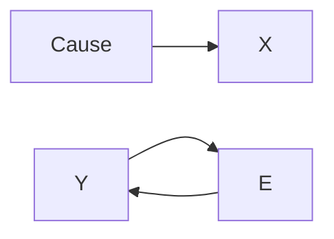

# ArchiScript

A Lean calculus for making architectural assumptions and member consequences
explicit before implementation.

ArchiScript makes architectural ignorance visible as an unmet semantic or proof
obligation. An omitted outcome should not disappear behind a convenient carrier,
a hidden member branch, an invented waiting loop or an unexplained tensor join.

## Review target: a priori semantic possibilities

ArchiScript sits between high-level architecture diagrams and existing or
proposed code. It is a calculus for **reviewing the declared architecture as a
whole system of semantic possibilities and their joint consequences**, not a
tool for producing a final C4 diagram or simulating an implementation.

Model the full meaningful possibility space **a priori**, before an individual
execution selects an outcome. VDP members denote semantic regions, not observed
runtime values. Operations state partial maps between those regions; Causes,
supplier provenance, contexts and Cones constrain which joint consequences
are possible. Lean verifies obligations about that declared interpretation,
without choosing concrete runtime outcomes or executing values.

The review presumes that the model describes the intended existing or future
code. Proving the model corresponds to code, and that its real-world boundary
is complete, remain separate responsibilities. Formal coverage of the
**declared** scope must likewise not be confused with the currently deferred
global Cone/Expression guarantee.

For recurring review objections, especially the distinction between
**functional Operations**, **multiple outgoing Operations**, and **joint
Cone Effects without timing claims**, see the [Reviewer FAQ](#reviewer-faq-recurring-semantic-and-scope-questions).

**Global Cone/Expression coverage: NOT AUTOMATICALLY VERIFIED.** Certificates
cover the declared semantic objects and derived contexts described below.
The checker does not establish that the union of declared Cones covers every
finite typed Expression generated by the primitive inventory. Per-Cone proofs
and local `effectCoverage` do not establish that global property. Real-world
inventory completeness remains an author assumption.

### Manual inventory audit

**Global Cone/Expression coverage: NOT AUTOMATICALLY VERIFIED.** Disconnected
declared nodes, rootless strongly connected components (SCCs), and unaccounted-for
subgraphs are not automatically excluded. `CertifiedDeclaredArchitecture` proves
its scoped fields, not that every declared node or Operation has a grounded Cone.



[UngroundedCycle.lean](ArchiScriptTests/UngroundedCycle.lean) accepts a restricted
certificate for this inventory although Y and E have no canonical Cause-rooted
producer. Its typed cyclic boundary does not prove grounding.
[SourceCoverage.sourceOnly](ArchiScriptTests/SourceCoverage.lean) likewise retains
unattached Y/E nodes in an accepted unobservable model.

Without dependencies or context predicates connecting it to a rooted route, the
isolated component supplies no producer and does not change that route's reachable
tuples. It can still create false confidence in inventory coverage. Conversely,
an unrelated component owned by an observable Cone can obstruct
`BoundariesComplete`: every owned node needs a path to an Effect boundary when
`NoObservableEffect` is unavailable. Marking a cyclic boundary may satisfy the
path condition without proving a rooted producer.

Before claiming architecture-wide completeness, the architecture/diagram author
must inspect the entire declared Cause, Node/VDP and Generator/Operation inventory,
including unused declarations and rootless cycles. Remove accidental leftovers,
document intentional unreachable components and exclusions, or repair omitted
Causes/dependencies and rerun local proofs. Record this as an author judgment,
not a Lean guarantee. Adding a connection requires fresh supplier and contextual
P/E checks. A reachable X with unsourced Y at a declared join remains a present
certification failure, not this deferred audit. The [0.8.0 plan](plans/0.8.0.md)
separates inventory-wide diagnostics from all-generated-Expression coverage.

## Reviewer FAQ: recurring semantic and scope questions

These questions reflect themes from independent architecture reviews.
The answers explain the intended semantics, the guarantees actually proved
by ArchiScript 0.7.0, and the limitations that remain open. They are intended
as context for critical discussion, not as rules limiting which concerns
a reviewer may raise.

### Why is there no arrow from one source member to two different outputs?

**Because one `Operation` is deliberately a partial function on semantic
members**, `run : X.MemberIndex → Option Y.MemberIndex`. A *single* Operation
maps a given source member to at most one target member; `none` means that
mapping is undefined. [`Operation.single_output`](ArchiScript/Operation.lean)
proves this, and [`HiddenWaitingBranch`](Test/Negative/HiddenWaitingBranch.lean)
is a controlled negative example.

This **invalid** sketch is *not Lean syntax*:

```text
one operation: decide
  Waiting --> Success
  Waiting --> Timeout    (Success and Timeout are distinct target members)
```

A branching or set-valued arrow does not fix the missing explanation. If the
*same* Operation really distinguishes success from timeout, the source
architecture must identify an **a priori semantic distinction** that determines
the outcome, or a justified additional Cause/supplier/context that supplies the
relevant information. That information need not be observed or predicted
beforehand. For example, [`PossibilitySpace`](ArchiScriptExamples/PossibilitySpace.lean)
uses a scenario carrier covering short wait, long wait and timeout possibilities
without claiming knowledge of a future execution. An honestly coarser result
VDP may be appropriate if the distinction is **not** claimed; merely merging
different outcomes into an opaque member must not masquerade as having proved
their separate behavior.

### Does that ban branching architectures or multiple outgoing Operations?

**No.** These are **different** declared Operations, not two results of one
Operation:

```text
          f : X → Y
source X <
          g : X → Z
```

Their possible consequences are not required to be mutually exclusive. One
Cause can have multiple distinct downstream producer paths, including paths
sharing a target or suffix. There is no restriction to a single outgoing
Operation per VDP. See [`RootCoherence`](ArchiScriptTests/RootCoherence.lean)
and [`SharedTargets`](ArchiScriptExamples/SharedTargets.lean). A named
[`Operation.Branch`](ArchiScript/Operation.lean) witnesses an entry in **one
functional map**; it is not an extra nondeterministic arrow.

### But does the Cone Effect tensor mean both branches exist together?

**It analyzes their consequences jointly, not their launch times.** The
derived Cone Effect has an explicit tensor of terminal **provenance
coordinates**. That is the full *candidate* product. Actual joint
`reachEffect` tuples must be justified by derived suppliers, a **common
declared boundary world**, the Effect provenance condition and applicable
context; correlations can exclude Cartesian tuples. The analytical tensor
does not construct a new architectural join Operation.

Neither tensor formation nor joint mathematical reachability supplies a
timestamp, a runtime scheduler, or a theorem that two Operations **will
start**, start independently, start simultaneously, or eventually run.
"Both will start at some finite time (perhaps years later)" is still a
*liveness* assertion not proved by 0.7.0. Relative order, synchronization,
`happens-before`, physical co-presence and delivery need separately declared
temporal semantics if they are important. The model's *same world* is not
automatically a *same instant*. See
[`DeclaredArchitecture.reachEffect`](ArchiScript/Consequence.lean).

### Is a tensor automatically a join, copy, or synchronization?

**No.** A VDP tensor is the full mathematical Cartesian product. An *actual
architectural join* needs one explicitly declared Operation with a tensor
source and independently derived suppliers for each factor. The certified
**input** context must prove exact full-tuple `Reach = Adm` and projection
coverage using independently derived upstream images. These obligations
concern which input tuples can be supplied together; they do **not** demand
that the consuming Operation be defined on every such tuple. Simply seeing
two branches, the same nominal target,
or an analytical Effect tensor cannot create that Operation or make an
inadmissible tuple reachable. See
[`CorrelatedJoin`](ArchiScriptExamples/CorrelatedJoin.lean),
[`SharedTargetJoin`](ArchiScriptExamples/SharedTargetJoin.lean) and
[`ContractCoverage`](ArchiScriptTests/ContractCoverage.lean).

### Does a verified tensor input make the outgoing Operation a total function?

**No.** The P/E obligations verify the **supplier input relation**, not the
definedness of the Operation that consumes it. At a supported tensor input
context `t`, P checks that every independently incoming factor member has
a partner in a full admissible tuple, without inventing any incoming
projections. E checks equality of the **full n-ary** reachable and admissible
tuple relations: `Reach_t = Adm_t`. Pairwise projections alone are not E;
neither P nor E says that the entire Cartesian product is reachable.

The consuming `g : Operation (X.tensor Y) Z` remains an ordinary **partial
member map**, `g.run : (X.tensor Y).MemberIndex → Option Z.MemberIndex`.
Even an input tuple in both `Reach_t` and `Adm_t` may map to `none`.
For example, with independently justified incoming images and correlated
supplier semantics, the following is consistent at the level of one
verified input context (illustrative notation, not Lean syntax):

```text
Full tensor members:  (x0,y0), (x0,y1), (x1,y0), (x1,y1)
Reach_t = Adm_t:     {(x0,y0), (x1,y1)}

g(x0,y0) = some z0
g(x1,y1) = none       # valid partiality on a reachable, admitted input
```

The images of both input factors are fully accounted for in admissible
partners; the cross-pairs are not declared reachable. No rule demands
`g(x1,y1) = some ...` or totality on the full tensor. An **asserted
downstream consequence** requires an actually defined mapping along its
producer route, which is a separate question. `none` is mathematical
undefinedness, **not** evidence that a runtime invocation did not happen.
See [`InputValid` and `defined_consequence`](ArchiScript/Consequence.lean),
[`Operation.run`](ArchiScript/Operation.lean), and
[`CorrelatedJoin`](ArchiScriptExamples/CorrelatedJoin.lean).

### What is the difference between a carrier, a Subdomain, and a selected VDP member?

These are **different roles**, not three levels of one hierarchy:

- **Carrier** (`Partition.Carrier`) is the underlying *type* of possible
  values, such as `String`. It is not itself a `Subdomain` or a parent
  node in a semantic derivation tree. It must retain invalid and unsuccessful
  cases when those values belong to the declared boundary.
- **Subdomain** (`Subdomain α`) is a named, inhabited *semantic region over*
  a carrier type `α`: its `meaning : α → Prop` specifies the subset, and
  it retains parent/definition evidence. Subdomains may be intermediate or
  supporting regions; merely declaring one does not select it for a VDP.
  For instance, `AllStrings : Subdomain String` can have meaning `True`,
  so its extension covers every string, but it is **still a Subdomain**, not
  the `String` carrier type.
- **Selected VDP member** is not an additional kind of semantic region:
  it is a `Subdomain` chosen by a particular
  `Partition.members : MemberIndex → Subdomain Carrier`. The selected
  family must be finite, nonempty, pairwise disjoint and cover the **entire
  carrier**; each selected region is inhabited. Other declared Subdomains
  can overlap, remain unselected, or refine a selected region.

For the **same** carrier `String`, a coarse VDP might select
`Invalid | Valid`, whereas a more detailed VDP selects
`Invalid | ValidAndPermitted | ValidAndDenied`. The `Valid` Subdomain is
selected in the first VDP but only intermediate/supporting in the second.
Neither VDP selects `Valid` *together with* either of its overlapping
children. Semantic refinement relates **Subdomains to Subdomains**, while
VDP membership is a **separate choice**; different VDPs may also use
different carriers.

See [the separate carrier/derivation/selection diagram](#from-subdomains-to-selected-vdp-members-a-string-carrier),
[`Subdomain`](ArchiScript/Subdomain.lean) and
[`Partition`](ArchiScript/Partition.lean).

### Is a VDP an enum of observed outcomes or a runtime validation pipeline?

**Neither.** First declare the complete meaningful carrier and justified,
inhabited `Subdomain` meanings. A VDP selects a finite, nonempty, covering,
pairwise disjoint family of **those Subdomains**. Supporting regions may be
finer than the selected members; a selected member need not be the leaf of
the finest available split. The carrier stays fixed *for that VDP's semantic
refinement*, not necessarily across different Operation endpoints. See
[the worked String example](#from-subdomains-to-selected-vdp-members-a-string-carrier)
and [`ProjectReference`](ArchiScriptExamples/ProjectReference.lean).
Observing a runtime value can identify a previously declared region; it
does not create the region after the fact.

### Why can an authorization service be a tensor factor if the request's outcome is already semantically distinguished?

**The a priori classification of possibilities is not an account of when a
running program learned the answer.** ArchiScript distinguishes (1) what
semantic cases exist, (2) which declared suppliers and architectural
dependencies participate in an outcome, and (3) what partial Operations
say about consequences. An Operation cannot invent an undisclosed
`Success`/`Error` choice for one unchanged source member; conversely,
the model does not assert that a real service has already executed.

Consider a **particular, justified permission policy** in which `V(s)`
means that a string is valid and `P(s)` means that the string is permitted.
A source `Request` VDP over the *full* carrier `String` may select:

```text
Request VDP (carrier: String; every member is Subdomain String)
  Invalid                 := not V(s)
  ValidAndPermitted       := V(s) and P(s)
  ValidAndDenied          := V(s) and not P(s)
```

All three selected regions must be inhabited, disjoint and cover the
carrier. This says **which case a value belongs to under the stated
semantics**, not whether the implementation has checked it yet. If the
same string can be permitted for one user, resource or policy version and
denied for another, then `P : String → Prop` is **not a justified complete
classification**: include the relevant information in an appropriate
carrier or justified input/supplier. The missing policy information must
not be concealed as a nondeterministic Operation arrow.

#### A service that can be available or unavailable

Now suppose a separate declared external Cause supplies a `ServiceStatus`
VDP. Its carrier describes the relevant service-condition evidence, with
two justified, inhabited regions `Available` and `Unavailable`.
For instance, an external *service-status report* may be the Cause, with
an appropriate declared boundary/context for the intended decision.
A developer/DevOps deployment can explain why a service exists, but
**completion of deployment is not proof of its later availability**.
If the Cause is merely a completed-deployment event, a single `Deployed`
member can express that much, not both live service states.

One **possible architecture sketch**, not a compiled Lean fixture.
The service-status supplier is an explicitly modeled architectural input,
**not** a claim that the unavailable service has itself returned a message.
In this example the status can be supplied by an external monitor/report:

```text
  CONE A: request                          CONE B: service status
  Cause: requestArrived                    Cause: serviceStatusReported
           |                                        |
           v                                        v
  +----------------------+              +----------------------+
  | Request VDP          |              | ServiceStatus VDP    |
  | Carrier: String      |              | (status evidence)    |
  |                      |              |                      |
  | Invalid              |              | Available            |
  | ValidAndPermitted    |              | Unavailable          |
  | ValidAndDenied       |              +----------------------+
  +----------------------+                         |
           |                                       |
           +-----------------+---------------------+
                             |
                             v
           INPUT: Request (x) ServiceStatus
           Full VDP tensor has 3 x 2 = 6 member pairs
                             |
          PROOF OBLIGATIONS (not runtime steps):
          P: incoming members have full admitted partners
          E: Reach = Adm on COMPLETE input tuples
                             |
                             v
          process : Request (x) ServiceStatus -> Response
          (ONE partial Operation; six defined cases shown)

          MEMBER-LEVEL MAP -- not a runtime execution order:

          (Invalid, Available) -----------+
                                           +---> some InvalidInput
          (Invalid, Unavailable) ---------+
                         ^                         ^
                         |                         |
              DIFFERENT STATUS            SAME RESPONSE

          (ValidAndPermitted, Available) -----> some Success
          (ValidAndPermitted, Unavailable) ---> some ServiceUnavailable
          (ValidAndDenied, Available) --------> some PermissionDenied
          (ValidAndDenied, Unavailable) ------> some ServiceUnavailable

                             |
                             v
                Response VDP (selected members)
                Success | InvalidInput
                PermissionDenied | ServiceUnavailable

  The two Invalid rows differ in the service-status FACTOR,
  but not in the mapped response. They are still TWO tensor inputs.
```

There are **six nominal tensor members** (three times two), not an
implicit instruction to run six cases. For example, an architect might
declare this **single** partial member map, shown here as fully defined
for illustration:

| Request member | Service Available | Service Unavailable |
| --- | --- | --- |
| `Invalid` | `some InvalidInput` | `some InvalidInput` |
| `ValidAndPermitted` | `some Success` | `some ServiceUnavailable` |
| `ValidAndDenied` | `some PermissionDenied` | `some ServiceUnavailable` |

This is one **design choice**, not an ArchiScript rule about error
precedence. The two `Invalid` rows show **output invariance under the
service-status member**, not the absence of an architectural supplier
dependency. In this sketch, even an `Invalid` request is an input to
`process : Request ⊗ ServiceStatus → Response` only as part of a **complete
tuple** whose status factor has a justified supplier. The fact
`Unavailable` is a *defined status member*, not `none` or a missing
supplier. If no status supplier exists, the tensor-sourced path cannot
silently treat that missing factor as `Unavailable`.

For the shown mapping, the member-level invariant is:

```text
forall status in {Available, Unavailable}:
    process(Invalid, status) = some InvalidInput
```

This proves the mapped answer does not vary *with the supplied status
value*. It does **not** prove that the status need not be supplied, that
the service was or was not invoked, that validation happens first, or
that a response is physically delivered. To **remove** the status
dependency for invalid input, the architect would need a separately
declared and verified path/Operation consuming the request without that
factor; two equal tensor-output rows do not create such a path.

One could instead choose to prioritize `PermissionDenied` when the
service is unavailable or leave selected mappings at `none`. The
Operation is **still partial by type**; a certified tensor input does
not require `some` for every reachable pair. `none` is mathematical
undefinedness, not a runtime event or an `Absent` VDP member. Response
members must themselves be justified regions of an appropriate response
carrier; they do not bypass Subdomain proofs.

The entry `(ValidAndPermitted, Unavailable) → ServiceUnavailable` is the
instructive case: the request belongs to a permitted semantic region,
yet the architectural consequence is an error because a **separate
required dependency is unavailable**. Permission, availability and
the actual response are different assertions. One can know the
semantically appropriate outcome *in the model* without claiming a
running implementation already knows or produces it.

#### What does tensor verification require here?

For an actual joined generator input, derive the incoming member images
from both **specific supplier histories**. The contract verifies the
projections of the complete admissibility relation against those
independently obtained images (P) and the **entire** reachable relation
against the declared admissible relation (E):

```text
P:  projection_i(Adm_t) = independentlyIncomingImage_i
E:  Reach_t = Adm_t           on complete tuples, not just pairs
```

If both Causes genuinely supply all their stated members in independent
admissible worlds, and the join's context imposes no correlation,
`Reach_t = Adm_t` **can** contain all six pairs. For example
`(Invalid, Unavailable)` and `(ValidAndPermitted, Unavailable)`
are perfectly meaningful pairs. Their presence does **not** establish
that an unavailable service was called or that a validator ran first.
If the sources are correlated or context restricts their co-availability,
only the supported subset belongs in `Reach_t`, and `Adm_t` must agree.
Drawing the tensor alone proves none of these claims.

P does **not** demand every Cartesian pair. It demands that each
*actually incoming* member at every factor has at least one admissible
complete partner, without inventing impossible partners. E checks
full-tuple equality and can expose a claimed pairing that the declared
supplier/world semantics cannot realize. Neither contract makes the
outgoing Operation total, guarantees service execution, or introduces
clock/scheduling/happens-before semantics. See
[`InputValid`, `InputSources` and `defined_consequence`](ArchiScript/Consequence.lean)
and [`CrossCone`](ArchiScriptExamples/CrossCone.lean).

#### Why not model separate Validation and Permission VDPs?

That is also legitimate **if the two factors and their actual suppliers
are meaningful**. But `{Valid, Invalid} ⊗ {Permitted, Denied}`
has four nominal pairs, including `(Invalid, Denied)` and
`(Invalid, Permitted)`. The input contract must explain which pairs
are actually reachable and admitted; it does not delete unwanted
tensor members. In an architecture audit, `(Invalid, Denied)` may
raise the question: *was invalid input incorrectly passed to an
authorization check after validation, or does `Denied` simply mean a
general refusal?* In new design it may suggest a needless stage,
but it is **not automatically a bug**. A tensor or common Effect
does not, by itself, prove that validation preceded authorization.
A sequential forwarding claim needs the corresponding declared
producer/Operation path and its semantics.

Likewise, declaring `SuccessMessage` and `ErrorMessage` as **two
separate terminal Effect coordinates** is different from making them
**alternative members of one Response VDP**. If each coordinate has an
individually possible result but they cannot coexist in any admissible
world, the observable Cone's full-Effect projection/inhabitedness
obligations can expose that mismatch. `none` from a partial Operation
does not supply an implicit "no message" member. The correct
representation depends on whether the intended observation is one
alternative result or two independently meaningful consequences.

#### When is a one-member service VDP enough?

If the intended fact is only "a deployment has completed" or "this
dependency is declared present", a one-member VDP such as `Deployed`
may be perfectly meaningful. Tensoring it with the three-member
request VDP gives **three member pairs**: a typed dependency with
explicit provenance but no extra decision alternatives. It does not
represent `Unavailable` or explain outages. A **two-member**
`Available/Unavailable` VDP is needed when the architecture really
distinguishes those states, together with a justifiable supplier that
can account for them. Neither an arbitrary invented Cause nor the
mere presence of a service box gives the model independent evidence.

**Design lesson.** A single refined request VDP, separate semantic
Validation/Permission factors, and a request VDP tensor a service-status
VDP are *different architectural decompositions*. No one form is
universally preferable. The calculus can check their declared partitions,
partial maps, supplier provenance, tensor-context P/E obligations and
observable Effect claims; it cannot choose the right service boundary,
verify real deployment health, discover omitted real-world conditions
or prove runtime implementation conformance. Its a priori purpose is
to make the architect's assumptions and resulting consequences
explicit enough to challenge **before** or **during** implementation
review.

### Can repeated Causes, cycles, or timeouts be simulated by adding arrows?

**Not without modeling the added assumptions.** One Cause in the current
Cone API denotes one concrete external event and its canonical origin.
Fan-out of that event is valid; invented repeated invocations are not.
A typed cyclic observation boundary describes finite producer derivations,
not a polling scheduler, a termination guarantee, or a physical clock.
Finite VDP members alone do not make the provenance history finite.
See [`RootCoherence`](ArchiScriptTests/RootCoherence.lean),
[`CyclicCone`](ArchiScriptExamples/CyclicCone.lean) and
[`Provenance`](ArchiScript/Provenance.lean).

### Can a scoped certificate accept a disconnected node or rootless cycle?

**Yes, without proving that component has an executable producer.**
The [`UngroundedCycle`](ArchiScriptTests/UngroundedCycle.lean) regression is
intentionally an accepted **scoped** certificate with an ungrounded component;
it proves absent images rather than invented consequences.
[`SourceCoverage`](ArchiScriptTests/SourceCoverage.lean) distinguishes this
case from a *declared tensor use with a genuinely incoming factor and a
missing partner*: the latter must fail the mandatory `inputSources` obligation.
Complete inventory grounding and rootless SCC diagnostics remain a
[manual review obligation](#manual-inventory-audit) and a
[0.8.0 backlog item](plans/0.8.0.md); they are not quietly proved by
`CertifiedDeclaredArchitecture`.

### Does a passed certificate prove global Cone/Expression coverage?

**No. Global Cone/Expression coverage: NOT AUTOMATICALLY VERIFIED.**
The certified declaration enforces its stated local source, context,
provenance, input and Cone Effect obligations. It does **not** establish
that every generated finite Expression belongs to a declared Cone. Report
that stronger claim as **UNKNOWN**, even when CI is green.
Do not convert an optional 0.8.0 global theorem into a blocking 0.7.0
requirement, or present the restricted certificate as universal assurance.
See [the 0.8.0 plan](plans/0.8.0.md).

### Can Lean verify that the stated admissibility contract is a true business requirement?

**No.** `admissibleInput` and `admissibleEffect` are authored mathematical
contracts. Lean verifies proofs *relative* to them; the trust audit can
reject improper dependencies on reference Reach, but cannot discover omitted
real-world conditions or prove the author's judgment independent of the
architecture. Distinguish **Level A** formal validity of the declared model
from **Level B** external adequacy and evidence. Missing real-world
requirements are an architecture-review risk, not something to fix by
weakening the mathematics.

### Does ArchiScript prove a deployed implementation follows the architecture?

**No.** The 0.7.0 Lean core can specify a proposed architecture **before
code exists**. Review records and optional source-code bindings are
engineering handoff metadata; they are not runtime conformance proofs.
Versioned implementation evidence or separate temporal/concurrency analysis
can be valuable *additional* checks, but must not be misreported as already
proved or made prerequisites for defining a mathematical architecture.

## Semantic foundation

Declare a complete meaningful carrier, including failed, invalid and absent
cases. Declare named semantic Subdomains and their ancestry. Prove every declared
split. Select a finite nonempty family of those regions as the VDP's members.

### From Subdomains to selected VDP members: a `String` carrier

Take `String` as the carrier: **all strings**, including empty, malformed,
invalid, valid-but-denied and valid-and-permitted values. For this source VDP,
the carrier remains `String` through every semantic refinement; it is never
replaced by an enum of outcomes or narrowed to successful cases. This is a
local statement about refining one VDP: other VDPs, including the target of
an `Operation`, may use different carriers.

A `Domain String` is a predicate, which may describe an empty region.
A `Subdomain String` is a **named, inhabited** semantic region carrying its
meaning, parent/definition evidence and containment proof. Subdomains are the
building blocks; **a selected VDP member is itself a Subdomain**, not a separate
kind of object. A Subdomain does not have to be selected by any particular VDP.

Keep the **carrier type**, **Subdomain derivation**, and **VDP member
selection** separate. `String` is a type, **not a node or parent in the
Subdomain hierarchy**. Every region below is a `Subdomain String`, with a
meaning predicate on the same `String` carrier.

The architect can derive those regions by proved `SemanticSplit`
declarations:

```text
Carrier type (not part of the tree): String

Subdomain String derivation:
AllStrings                   <- root Subdomain; meaning(s) := True
├── Invalid                  <- Subdomain
└── Valid                    <- Subdomain
    ├── ValidAndPermitted    <- Subdomain
    └── ValidAndDenied       <- Subdomain

Fine-grained VDP selection (not a tree edge):
  Carrier: String
  Selected members: Invalid | ValidAndPermitted | ValidAndDenied
```

The tree relates **Subdomains to other Subdomains** by semantic refinement.
The VDP separately selects regions from that derivation; it does not place
the carrier above them or add new kinds of semantic region.

First, split `AllStrings` into `Invalid` and `Valid`; then split
`Valid` into `ValidAndPermitted` and `ValidAndDenied`. The predicate for
permission must be independently justified and meaningful on the declared
carrier. If permission needs external state not contained in `String`, that
information must be supplied explicitly in an appropriate carrier or through
a justified Cause/supplier dependency; it cannot be inferred from the string
alone.

For example, let `V(s)` express validity and `P(s)` an independently
justified permission predicate on strings. The **selected** regions have
meanings:

```text
Invalid(s)           := not V(s)
ValidAndPermitted(s) := V(s) and P(s)
ValidAndDenied(s)    := V(s) and not P(s)
```

Their union is the **entire** carrier, not merely the valid strings:

```text
forall s : String,
  not V(s) or (V(s) and P(s)) or (V(s) and not P(s))
```

The regions are pairwise disjoint. Each named Subdomain must **also** have a
separate inhabitance proof: logical coverage by itself does not establish that
all three regions are nonempty. Each declared `SemanticSplit` proves its
children are contained in the parent, cover that parent and are disjoint;
its children are already inhabited Subdomains.

`SemanticSplit.refine` can flatten these proved nested splits (using a
singleton split on the `Invalid` branch). `Partition.ofSplit` then constructs
a `VDP` / `Partition` from the leaves, with proof that `AllStrings` covers
every `String`. The VDP selects exactly `Invalid`, `ValidAndPermitted`
and `ValidAndDenied` as members; `Valid` and `AllStrings` remain part of
the derivation, but are **not** also selected as members. `MemberIndex`
identifies these three chosen regions.

**A VDP member need not be a leaf of the finest available split.** The same
`String` carrier also admits a coarser VDP selecting just `Invalid` and
`Valid` as its two members. There, `Valid` is a selected member while
`ValidAndPermitted` and `ValidAndDenied` remain meaningful, unselected
supporting Subdomains. Do not select `Valid` together with either overlapping
child in the same VDP. Both resolutions require nonempty selected members,
full-carrier coverage and pairwise disjointness; choose the resolution whose
member distinctions are justified by downstream architectural needs.

A subsequent single `Operation` may map those source members to
`Rejected`, `Accepted` and `Rejected`, respectively, in a result VDP. That
result VDP can have a different carrier (for example, a `Decision` type):
`Operation` maps source member indices to target member indices, not concrete
strings to concrete decisions.
Trying to map one coarse `Valid` member to both distinct results in the
same Operation is a signal of a missing source distinction, not a reason to
introduce an unexplained nondeterministic member arrow.

This is **logical funneling of semantic distinctions**, not a runtime
validation pipeline or a succession of executed checks. A hierarchical tree
is one useful derivation, not a mandatory global taxonomy: flat selections,
independent overlapping supporting Subdomains and justified coarsenings are
also legitimate. The formal question is always whether the **selected**
Subdomains partition the full declared carrier, and why those distinctions
are meaningful for downstream architectural consequences.

The existing [project-reference example](ArchiScriptExamples/ProjectReference.lean)
shows the same construction with eight proved leaves using
`Subdomain.child`, `Subdomain.remainder`, `SemanticSplit.refine` and
`Partition.ofSplit`. [FormInput](ArchiScriptExamples/FormInput.lean) shows
different granularities over an unchanged `String × String` carrier.

### A priori possibility space

Before validating downstream consequences, the architect states the meaningful
boundary carrier, outcome-relevant predicates, external Causes, primitive
Operations, context/availability assumptions and independent admissibility
contracts. The model accounts for the possible cases and their conditions in
advance. A running implementation can discover which case holds later.

This is knowledge of **possible behavior**, not foreknowledge of one execution.
Possible PRNG or CSPRNG outputs can be modeled without predicting a sample or
specifying a distribution; a VDP carries no probability weights. Lean proves
facts about the declared interpretation, not that it captures the real world.

One Cause denotes one concrete external event and has one whole initial VDP:
`ArchitectureSignature.start c` selects its node, and `object (start c)` its VDP.
Several downstream Operations can express non-exclusive possible structural
consequences of that same source occurrence. They add neither initial VDPs nor
external invocations, and imply no parallel runtime execution.

Information need not all reside in a Cone's first VDP. Explicit external Causes,
sourced factors, provenance and justified context can contribute it through
declared dependencies and joins. A new distinction needs an explained semantic
source before the affected Operation's member mapping is asserted.

| Concept | Enforced meaning |
| --- | --- |
| `Partition.Carrier` | Full declared type of possibilities, unchanged by semantic refinement |
| `Domain α` | Predicate; intermediate emptiness is permitted |
| `Subdomain α` | Explicit base, definition evidence, containment and inhabitant |
| `SemanticSplit parent` | Finite nonempty children covering the parent, internally disjoint |
| `VDP` / `Partition` | Declared Subdomain members with full carrier coverage and disjointness |
| Selected VDP member | A declared `Subdomain` chosen by `members : MemberIndex → Subdomain Carrier` |
| `Operation X Y` | Possibly partial, non-surjective member map between whole verified VDPs |
| `Expression G X Y` | Finite linear chain of registered Operations between nominal objects |
| `Presentation` | Nonlinear algebraic presentation syntax, separate from linear routes |
| Cause / Cone | One originating Cause, explicit root instance and all supported consequences |
| Contextual Effect | Terminal boundary image or full Cone-effect tuple relation |

Different decomposition trees may share a root and overlap across trees. Flat
member selections and coarsenings remain valid. Every **named** Subdomain is
nonempty; an empty string, array or absence value is not the empty set.
`Partition.classify` is a derived classical lookup, never a construction field.
Carriers may be infinite while member families remain finite.

The [project-reference example](ArchiScriptExamples/ProjectReference.lean)
uses verified deductive splits for all eight URI success/failure leaves. Its
symbolic URI/filesystem interpretation is explicit; it is not a parser or a
proof that real filesystem observations are truthful. A counterexample rejects
promoting only the successful leaves into the full URI boundary.

### Click, wait and timeout

For one external lobby-entry click, choose a declared **scenario** carrier with
an arbitrary natural-number waiting budget `b` and `readyAfter : Option Nat`.
`some d` means readiness after `d` abstract ticks; `none` means no readiness in
that scenario. The example adopts success at the deadline and a short-wait
threshold of two ticks.

| Initial semantic member | Predicate over the scenario | Witness `(b, readyAfter)` | `decide` result |
| --- | --- | --- | --- |
| `ShortWait` | Readiness at `d ≤ 2` and `d ≤ b` | `(5, some 1)` | `Success` |
| `LongWait` | Readiness at `2 < d ≤ b` | `(5, some 4)` | `Success` |
| `Timeout` | No readiness, or readiness at `b < d` | `(5, none)`; also `(5, some 6)` | `Timeout` |

[PossibilitySpace.lean](ArchiScriptExamples/PossibilitySpace.lean) proves these
regions nonempty, exhaustive and disjoint over the entire infinite carrier and
defines `decide : Operation click result`. Zero budgets, immediate readiness,
deadline equality and arbitrarily late readiness remain present. It proves the
partition/map layer, not a complete Cause/Cone certificate.

This carrier is a declared mathematical boundary, **not raw-input validation**.
Its interpretation assumes readiness is meaningfully summarized by a delay;
cancellation, malformed requests or other relevant conditions need explicit
semantics if the real boundary includes them. The program need not read or
predict a future delay at click time. The model states possible scenarios; it
proves no eventual readiness, timeout delivery, timing bound or implementation
waiting strategy.

A literal singleton `Click` cannot be split into three inhabited disjoint
regions merely by naming them after outcomes. For a lobby requiring N people,
state the relevant environmental distinctions or explicitly sourced dependency.
Do not invent N parameterized Causes or a polling self-loop merely to depict
waiting. A genuine declared architectural cycle remains legal.

### An unexplained branch is a modeling failure

One coarse input member `Waiting` cannot map to both unequal members `Success`
and `Timeout` through **one and the same Operation**. Its
`Operation.run : X.MemberIndex → Option Y.MemberIndex` is a partial function;
`Operation.single_output` proves that two defined outputs at one input are equal.
[HiddenWaitingBranch.lean](Test/Negative/HiddenWaitingBranch.lean) deliberately
fails when authoring the second conflicting branch.

Refine an appropriately broad carrier, add an explicitly sourced factor, or
justify the context-specific semantics before declaring that map. Making the
proof pass by discarding a possible case hides the architectural problem.
Separate outgoing Operations `f : X → Y` and `g : X → Z` are valid fan-out.
`none` is mathematical undefinedness, not an undocumented alternate output or a
claim that a runtime Operation did not execute.

## Operations, tensor and provenance

`g.comp f` composes defined member mappings. `none` denotes mathematical
undefinedness, without a runtime execution claim. Several outgoing Operations
are non-exclusive possible structural routes, with no scheduler or liveness rule.

Tensor preserves the full Cartesian carrier and member product, including self
tensor. Coproduct preserves tagged alternatives. Common-source fan-out creates
no implicit diagonal Operation. At an actual tensor use, the relevant questions are

\[
\begin{aligned}
\text{(P)}\quad &\forall i,\quad \pi_i(\operatorname{Adm}_t)=I_i,\\
\text{(E)}\quad &\operatorname{Reach}_t=\operatorname{Adm}_t.
\end{aligned}
\]

### Level A: correctness of the stated local contract

For `t : X₁ ⊗ ... ⊗ Xₙ`, identify every actual producer occurrence and its
provenance. Derive each incoming image `Iᵢ` independently from that supplier's
semantics, before restricting the join. `Adm_t` is an independently authored
predicate on **full tuples**. `Reach_t` is the reference relation from the actual
provenance, boundary/world and context assumptions.

**P is necessary coverage, not sufficient joint behavior.** Every actual incoming
member needs at least one admissible full partner tuple, and the contract must
not invent unsupplied coordinates. **E compares the complete relation in both
directions.** Every reachable tuple must be approved and every approved tuple
must be reachable. Neither projections, pairwise checks nor selected examples
establish E.

Together P and E are the exact adequacy criteria for a local formal contract
defined by these obligations, with the API's additional inhabited/unreachable
status requirements. This is a conditional mathematical result for that stated
contract, not a theorem that every architectural design is correct. Declare
`Adm` independently; setting `Adm := Reach` or assuming equality through an
unchecked axiom supplies no independent contract. Proof audits and named
assumptions remain part of the evidence.

Neither an Operation nor a supplier must reach every member of its target VDP.
`Adm` and `Reach` may be proper subsets of the unchanged full product.
Crucially, these input-relation obligations **do not require the consuming
Operation to be total**, even on admitted and reachable full tuples:
`g.run tuple = none` remains permitted. P/E checks the complete tensor
input relation, not the definedness or surjectivity of `g.run`.

### Correlation, partners and complete tuples

Let `f,g : X → Bool` both preserve the input Boolean from **one shared Cause
occurrence**. The supplier paths remain distinct. A declared downstream
`j : Bool ⊗ Bool → R` explicitly consumes both:

| Pair in the full mathematical tensor | Common-source `Reach` | Independent diagonal `Adm` |
| --- | --- | --- |
| `(false, false)` | Reachable | Admissible |
| `(false, true)` | Unreachable | Excluded |
| `(true, false)` | Unreachable | Excluded |
| `(true, true)` | Reachable | Admissible |

[CorrelatedJoin.lean](ArchiScriptExamples/CorrelatedJoin.lean) proves the exact
input relation and its projections. Declaring all four pairs admissible would
fail E unless independent semantics actually supplied the off-diagonal pairs.
Fan-out and equal VDP names create no join: the consuming generator and both
supplier histories must exist. The terminal Cone-effect tensor is an analytical
product; it adds no architectural join Operation.

If an incoming factor can produce `a` but no full admissible tuple contains `a`
at its position, P fails: `a ∈ Iᵢ` but `a ∉ πᵢ(Adm)`. A contract tuple using an
unsupplied member fails the reverse inclusion. A constant producer may reach
only `true` in a Boolean VDP; unreachable `false` needs no partner. If a required
factor has no supplier while another has an inhabited incoming image, losing
the complete input term does not discharge these obligations: no full tuple
can cover that supplied member. Such a use must surface as missing/unverified,
not disappear from certification.

Three Boolean factors show why P alone cannot suffice. Suppose `Reach` contains
all eight triples, while independently declared `Adm(a,b,c)` means
`c = xor a b`:

| Relation check | Result |
| --- | --- |
| Each coordinate projection | Both relations contain `false` and `true`; P passes |
| Every pair extends to a full tuple | Both relations have all four pairs at every pair of positions |
| Full tuples | `Adm` has four triples; `Reach` has eight; E fails |
| Concrete counterexample | `(false, false, true)` is reachable but prohibited |

[TensorVerification.lean](ArchiScriptTests/TensorVerification.lean) proves
`pairwise_is_insufficient` and records the four excluded triples, an orphaned
incoming member, and the legitimate strict image of a constant supplier.
[ContractCoverage.lean](ArchiScriptTests/ContractCoverage.lean) applies these
failures to typed generator inputs with actual producers: an orphan, an invented
coordinate, and a three-factor relation whose projections pass while E fails.
Projection coverage exposes missing partners early; passing it never licenses
skipping the full n-ary relation.

`ArchitectureSignature` closes the declared primitive, Cause, node, domain and
split inventories. `Inputs` records actual generator suppliers. Finite provenance
`Term`s retain root instances and producer histories; they are not single linear
Expressions. Equal VDP denotations do not merge nominal nodes or factor positions.
`isInputContext` derives local contexts from their real originating roots.
`Term.RootCoherent` requires every Cause occurrence, including a nested external
supplier, to use that Cause's designated origin. Distinct producer paths from
that origin remain distinct and can be joined.

Every declared generator must also satisfy `InputSources`, before a complete
input term is available. It requires coherent suppliers at every factor or proof
that all independently incoming factor images are empty. One supplied X and a
missing Y cannot bypass a declared `X ⊗ Y → E` check.
`CertifiedDeclaredArchitecture.input_partner` proves that every independently
incoming member has a full admissible, reachable partner tuple. Choosing one
grounding witness does not restrict the universal checks on other input contexts.

Two distinct external Causes may have equal initial VDPs while remaining
provenance-distinct. An explicit cross-Cone join is legitimate;
[CrossCone.lean](ArchiScriptExamples/CrossCone.lean) supplies one local and one
external factor with declared boundary and availability semantics. By contrast,
combining two invocations of the **same** Cause at different simulated times is
outside the current single-event Cone API. That would require a separate future
external multiple-event simulation/composition extension. Neither valid fan-out
nor legitimate cross-Cone joins should be removed to hide this distinction.

The reference relation includes every finite derivation from the inventory,
including recursive cross-Cone dependencies. Availability is an explicit
semantic assumption. No default physical persistence, consumption, synchronization
or resource-effect semantics is introduced.

## Cycles and proof-backed checking

A cycle needs a real typed entry and observation boundary. `Term.CycleBoundary`
records a nontrivial return with one entry hole and explicit auxiliary suppliers.
Repeated traversals of that return contribute to the selected boundary image;
they do not add a factor per iteration. Distinct producer entries remain distinct,
including when they enter the very same marked node.

Reachable sets may stabilize while the Operation continues alternating.
[The swap example](ArchiScriptExamples/CyclicCone.lean) proves both facts and
connects its boundary image to a finite exact analysis through `ExactAbstraction`.
A finite VDP alphabet does not imply finitely many occurrence histories.
The provenance proof cache requires every Cause's designated origin and a seeded,
closed, realized finite normalized-history basis (`effectCoverage`).
It need not enumerate every value of the root-instance type; unsupported
additional invocations cannot enter accepted derivations.
The optional `derive_provenance` helper caches candidate data; it does not supply
this proof or infer closure from a fuel limit.
`FiniteAnalysis.certify` checks closure of the entire analyzed state before
returning an `Exact` result; an unchanged terminal projection is insufficient.

`CertifiedDeclaredArchitecture` requires a nonempty Cause inventory, source
accounting for every generator, proofs for all derived local input contexts,
and an explicit `ConeStatus` for every Cause. An observable Cone needs a real
Effect coordinate, a reachable full tuple, P/E proofs and complete terminal
boundaries. An unobservable Cone needs `NoObservableEffect`: every Effect
coordinate's incoming image and its admissibility relation are empty. This
admits an intentionally source-only event without inventing an observation;
it cannot hide missing input suppliers. The tensor unit never counts as an
observable Effect. [SourceCoverage.lean](ArchiScriptTests/SourceCoverage.lean),
[Unobservable.lean](ArchiScriptTests/Unobservable.lean) and
[UngroundedCycle.lean](ArchiScriptTests/UngroundedCycle.lean) check these cases.

Certificates establish necessary obligations of the declared model. They do not
establish missing real-world requirements, production-code conformance, fairness,
termination, races or physical concurrency.

### Level B: correctness of the real-world design

Even a fully proved model of its declared scope is necessary evidence, not
sufficient proof that the proposed architecture is complete, appropriate,
implementable, secure, performant or faithful to production. An author can omit
an external Cause, choose the wrong carrier or predicates, or approve the wrong
`Adm`. Lean checks implications within the supplied interpretation; external
validity needs architectural scrutiny and separately modeled evidence.

Report two verdicts: which mathematical obligations were proved for the declared
scope, and which external assumptions or design risks need human review.
**Global Cone/Expression coverage: NOT AUTOMATICALLY VERIFIED.** Local/per-Cone
success does not establish the deferred universal generated-path guarantee.

## Algebra

The calculus provides partial-map identity/associativity, symmetric monoidal
coherence/naturality, coproduct universal properties, canonical tensor/coproduct
distributivity, semantic VDP isomorphisms, refinement/coarsening and conditional
consumer factorization. Isomorphisms preserve the primary semantic predicates.

`Presentation.Rewrite` checks Operation equality; `Presentation.Transport` checks
an explicit isomorphism square. These are local algebraic facts, not Cone-effect
equivalence. Composition never deletes intermediate nominal objects; a view
hiding them is an architecture projection. Selected `Presentation.Family` values
are useful views, not completeness certificates.

## Build and trust boundary

Lean/Lake are pinned to **4.34.0**. Runtime examples need Node; repository tooling
uses Python through `uv`. Optional review PDFs use Tectonic.

```bash
uv run --no-project python scripts/verify-lean.py
uv run --no-project python -m unittest discover -s scripts -p 'test_*.py'
node --test examples/payment-webhook.test.mjs
```

The first command cleans and builds with warnings as errors, checks the public-library
skill smoke, audits compiled transitive axioms, runs intended-diagnostic negative
fixtures and invokes kernel replay with explicit module names. Reports are in
`.lake/reports/verification.json` and `.lake/reports/axioms.json`. Verification
rejects changing sources, direct/transitive `sorryAx`, custom axioms, extra trusted
computation axioms and tagged conditional certificates disguised as concrete ones.
The conventional allowlist is `propext`, `Classical.choice`, `Quot.sound`.

The [PR Gate workflow](.github/workflows/pr-gate.yml) runs the same verification
script and uploads `.lake/reports/` as the `lean-proof-reports` artifact, including
on failure. The verification report identifies its checked commit, source digest
and command results.

The audit inspects the actual admissibility fields of every closed model and
certificate declaration in the checked imports, regardless of tags, following
inline, indirect and opaque aliases.
It rejects dependencies on reference Reach/evaluation and fails closed if a
closed record cannot be inspected. Constructing a certificate alone does not run
this audit. Mathematical set equality and the dependency check cannot establish
the correctness of a domain requirement.

## Examples and authoring

- [Public-only smoke](skills/archiscript/examples/CurrentApi.lean): explicit regions, split, VDP, primitive inventory and scoped certificate.
- [Click possibility space](ArchiScriptExamples/PossibilitySpace.lean): infinite scenario carrier, short/long/timeout semantic partition and functional decision map.
- [Correlated join](ArchiScriptExamples/CorrelatedJoin.lean): common-source diagonal and constant non-surjective supplier.
- [External cyclic supplier](ArchiScriptExamples/CrossCone.lean): one local and one external factor with typed cyclic observation.
- [Mutually dependent Cones](ArchiScriptExamples/MutualCones.lean): joint reference semantics and certified finite query analysis.
- [Shared targets](ArchiScriptExamples/SharedTargets.lean): certified one-Cause Cones with one C, one h;k suffix, two derived coordinates, equal/different images and joint correlations.
- [Explicit shared-target join](ArchiScriptExamples/SharedTargetJoin.lean): one registered C ⊗ C → R, with exact full-tuple and projection proofs for every input context; this fixture does not claim a complete Cone certificate.
- [Terminal regressions](ArchiScriptTests/TerminalOccurrences.lean): shared-target coordinates and rejection of a collapsed supplier.
- [ReservationController](ArchiScriptExamples/ReservationController.lean): algebraic stress model, with nonlinear Presentations and linear primitive-consumer routes.
- [Release notes](docs/0.7.0-release.md): API migration and verification scope.

Use the [authoring skill](skills/archiscript/SKILL.md) for model construction and
proof workflows. Optional workflow modules (`Boundary`, `Review`,
`Operation.Declaration`, registry-based parameterization) require explicit imports.
Their approval and binding records are separate from mathematical certification.
Webhook review packs are projections of example models, not Cone certificates.

See [CONTRIBUTING.md](CONTRIBUTING.md) for the repository's PR/merge policy and
[LICENSE](LICENSE) for licensing.

Shared targets preserve distinct producer derivations automatically. One C
and one shared h;k declaration can yield two Effect coordinates of the same VDP;
equal members, images or suffixes do not merge those coordinates. Only an
explicit, fully supplied tensor-source Operation performs an architectural join.
The candidate Effect tensor is an analytical product, not that Operation.
`effectCoverage` checks a seeded, closed and realized finite provenance basis;
`EffectProvenance` prevents substituting a different producer in a coordinate.
Typed cyclic markers separately aggregate repeated traversals of their actual
return routes, while reference reachability retains every finite traversal.
